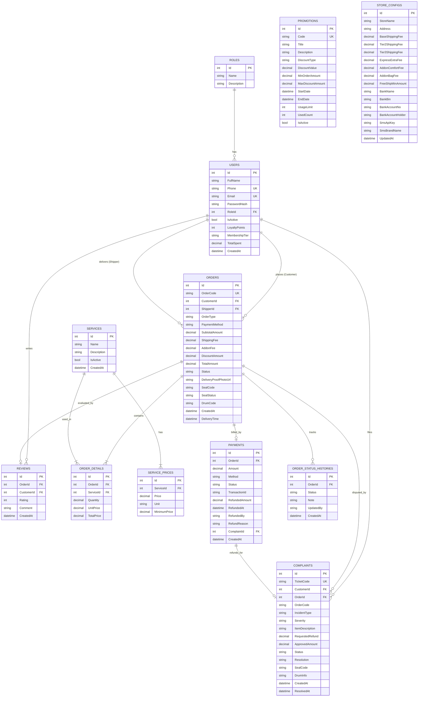

# ĐỒ ÁN TỐT NGHIỆP: HỆ THỐNG QUẢN LÝ & ĐIỀU PHỐI GIẶT ỦI THÔNG MINH (WASHSMART 3T)

## 1. Giới Thiệu Tổng Quan
Hệ sinh thái **WashSmart 3T** là giải pháp số hóa toàn diện quy trình giặt ủi công nghệ cao, kết nối thời gian thực giữa Khách hàng, Shipper giao nhận, Nhân viên quầy và Ban quản trị hệ thống:
1. **Backend Web API (.NET 8 C#)**: Cung cấp toàn bộ RESTful API, quản lý logic giặt sấy, đối soát thanh toán tự động, SignalR Hub thời gian thực, sinh mã VietQR EMVCo chuẩn NAPAS 247 và cơ chế bảo hiểm 3T Care.
2. **Web Portal Quản Trị & POS Quầy (HTML5 / Tailwind CSS / ES6 / SignalR)**: Dashboard chỉ số KPI thời gian thực qua WebSockets, Tiếp nhận đơn quầy POS tích hợp in hóa đơn & mã seal điện tử, Bản đồ điều phối tuyến giao nhận tối ưu (TSP 2-Opt & OSRM), và Trung tâm thẩm định bồi hoàn khiếu nại.
3. **Mobile App (Flutter / Dart)**: Ứng dụng di động đa nền tảng dành cho Khách hàng (đặt lịch giặt sấy, theo dõi tiến độ, gửi khiếu nại bảo hiểm 3T Care) và Shipper (nhận ca giao nhận, cân đo tại chỗ, quét mã VietQR và chụp ảnh chứng thực giao hàng).

---

## 2. Cấu Trúc Mã Nguồn Chuẩn Đồ Án Tốt Nghiệp

```
DoAnTotNghiep/
├── WashSmart3T_Backend/                    # Backend C# ASP.NET Core 8 Web API
│   ├── Controllers/                        # Payments, Orders, Complaints, Users, StoreConfig, Auth...
│   ├── Data/                               # ApplicationDbContext & DbSeeder (khởi tạo dữ liệu mẫu chuẩn)
│   ├── DTOs/                               # Data Transfer Objects (Validation & Binding)
│   ├── Hubs/                               # SignalR Realtime WebSockets (OrderNotificationHub)
│   ├── Middleware/                         # SecurityValidationMiddleware (kiểm tra IsActive tươi)
│   ├── Migrations/                         # Entity Framework Core Migrations
│   ├── Models/                             # Entity Models (Order, Payment, User, Role, OrderDetail...)
│   ├── Services/                           # VietQrService (EMVCo), SmsService, OtpManager, AccountLockout...
│   ├── store_config.json                   # Cấu hình cửa hàng & tài khoản VietQR
│   ├── appsettings.Example.json            # Mẫu cấu hình môi trường an toàn
│   ├── WashSmart.API.sln                   # Visual Studio Solution
│   ├── WashSmart.API.csproj                # C# Project file
│   └── Program.cs                          # CORS an toàn, JWT Bearer, SignalR, Rate Limiting & DI
├── WashSmart3T_Web/                        # Web Portal Quản Trị, Thu Ngân & Điều Phối
│   ├── index.html                          # Dashboard phân tích doanh thu & hiệu suất (SignalR Live)
│   ├── pos.html                            # Tiếp nhận đơn quầy, VietQR động & mô phỏng Webhook đối soát
│   ├── dispatch.html                       # Bản đồ định tuyến ngắn nhất (Thuật toán TSP 2-Opt & OSRM)
│   ├── complaints.html                     # Thẩm định khiếu nại & đối soát Dấu Seal 3T Care
│   ├── accounts.html                       # Quản lý nhân sự cửa hàng (Admin, Staff, Shipper)
│   ├── customers.html                      # Quản lý khách hàng, lịch sử chi tiêu & hạng thành viên
│   ├── orders.html, services.html, ...     # Quản lý đơn hàng, bảng giá dịch vụ
│   └── api.js                              # Client SDK kết nối đồng bộ Backend API
├── WashSmart3T_Mobile/                     # Mobile App Flutter đa nền tảng (Khách & Shipper)
│   ├── lib/                                # Mã nguồn Dart (screens, models, services...)
│   │   ├── screens/                        # home, booking, shipper, submit_claim, tracking...
│   │   ├── services/                       # api_service.dart, auth_service.dart
│   │   └── data/                           # laundry_catalog.dart
│   ├── android/ & ios/                     # Cấu hình nền tảng Native Android/iOS
│   └── pubspec.yaml                        # Dependencies (http, shared_preferences, qr_flutter, image_picker)
├── Database/                               # Kịch bản cơ sở dữ liệu
│   └── WashSmart3T_Database_Schema.sql     # Script khởi tạo SQL Server đầy đủ
└── README.md                               # Tài liệu kiến trúc & hướng dẫn vận hành
```

---

## 3. Danh Mục Tài Khoản Demo Hệ Thống (Mật Khẩu Mặc Định: `123456`)

Tất cả tài khoản demo dưới đây được khởi tạo tự động trong `DbSeeder.cs` và đồng bộ mật khẩu mặc định là **`123456`** để hội đồng thẩm định và người dùng dễ dàng đăng nhập kiểm thử:

| Vai Trò | Họ Và Tên | Số Điện Thoại | Mật Khẩu | Email Đăng Ký |
| :--- | :--- | :--- | :--- | :--- |
| **Quản trị viên (Admin)** | Nguyễn Kiều Như | `0900000000` | `123456` | `admin@washsmart.com` |
| **Nhân viên lễ tân (Staff 1)** | Trần Tuyết Mai | `0911000001` | `123456` | `mai.tran@washsmart.com` |
| **Nhân viên lễ tân (Staff 2)** | Lê Hoài Nam | `0911000002` | `123456` | `nam.le@washsmart.com` |
| **Nhân viên lễ tân (Staff 3)** | Đặng Thu Thảo | `0911000003` | `123456` | `thao.dang@washsmart.com` |
| **Nhân viên lễ tân (Staff 4)** | Đặng Thùy Dương | `0965112233` | `123456` | `duong.dang@washsmart.com` |
| **Shipper Giao nhận** | Lê Minh Hoàng | `0922222222` | `123456` | `hoang.le@washsmart.com` |
| **Khách hàng Demo 1** | Như Nguyễn | `0999222111` | `123456` | `nhu.nguyen@gmail.com` |
| **Khách hàng Demo 2** | Hoàng Tuấn Kiên | `0944444444` | `123456` | `kien.hoang@gmail.com` |

---

## 4. Hiện Thực Tính Năng Cốt Lõi (100% Khớp Mã Nguồn Thực Tế)

### 4.1. VietQR Chuẩn EMVCo Khóa Cứng Nội Dung `#WS3T-XXXX`
- **Mã hóa EMVCo TLV**: Backend tích hợp `VietQrService.cs` sinh chuỗi thanh toán đạt chuẩn EMVCo quốc tế (Tag 00 Payload format, Tag 01 Dynamic QR, Tag 38 Napas Beneficiary, Tag 54 Số tiền cố định, Tag 62 khóa nội dung đơn hàng `#WS3T-XXXX`).
- **Checksum CRC-16 CCITT**: Đa thức `0x1021` với seed `0xFFFF` đảm bảo tính toàn vẹn 100% khi quét qua mọi ứng dụng ngân hàng thương mại Việt Nam.
- **API Endpoint**: `GET /api/Payments/vietqr/{orderId}` trả về cả chuỗi EMVCo gốc và đường link mã QR ảnh hiển thị trực tiếp tại màn hình POS và Mobile.

### 4.2. Thanh Toán & Đối Soát Tự Động (Webhook & Sao Kê Ngân Hàng)
- **Cổng Webhook Ngân Hàng**: Endpoint `POST /api/Payments/webhook` tiếp nhận biến động số dư từ SePay, Casso, MBBank hoặc các cổng thanh toán Open Banking.
- **Khớp lệnh tự động**: Backend dùng Regex nhận dạng mã đơn `#?WS3T[-_\s]?(\d+)`, đối chiếu số tiền chuyển khoản với giá trị đơn hàng, tự động chuyển trạng thái `Payment.Status = Paid`, lưu lịch sử đối soát và phát tín hiệu SignalR cập nhật tức thì.
- **Đối soát hàng loạt**: Endpoint `POST /api/Payments/reconcile-statement` cho phép đối soát danh sách giao dịch sao kê ngân hàng theo lô (batch).

### 4.3. Thuật Toán Tối Ưu Tuyến Giao Nhận TSP (2-Opt Heuristic) & OSRM
- **Thuật toán 2-Opt Heuristic**: Tại `dispatch.html`, quy trình tìm lộ trình giao nhận nhiều điểm kết hợp 2 giai đoạn:
  1. *Greedy Nearest-Neighbor*: Khởi tạo chu trình đi qua tất cả các điểm dừng gom/giao hàng.
  2. *2-Opt Local Search (Edge Swapping)*: Lặp kiểm tra các cặp cạnh giao nhau và thực hiện đảo đoạn hành trình để triệt tiêu các cung đường tự cắt chéo, đưa lộ trình về trạng thái tối ưu cục bộ.
- **Động cơ OSRM & Geodesic Fallback**: Tích hợp gọi OSRM Driving Engine để vẽ tuyến đường thực tế theo mạng lưới giao thông, kết hợp thuật toán nội suy Haversine mượt mà trong trường hợp mất kết nối mạng.

### 4.4. Bảo Hiểm 3T Care & Dấu Seal Niêm Phong Điện Tử
- **Dấu Seal Niêm Phong Chống Tráo Đổi**: Mỗi đơn hàng khi xử lý giặt sấy xong (`Washing` $\to$ `Ready`) được tự động cấp mã niêm phong số hóa dạng `WS-SEAL-XXXX` và gán mã máy giặt sấy kiểm định (`LG-TURBO-0X`).
- **Thẩm định bồi hoàn thực tế**: Màn hình khiếu nại tại Web Quản trị và Mobile kết nối trực tiếp với thực thể đơn hàng trong CSDL. Khi duyệt khiếu nại (`PUT /api/Complaints/{id}/resolve`), hệ thống kích hoạt ghi nhận hoàn tiền bồi thường vào `Payment.RefundedAmount` và `Payment.ComplaintId`.

### 4.5. Dashboard KPI Thời Gian Thực (SignalR WebSockets)
- **SignalR Hub**: Khởi chạy Hub tại `/hubs/orders` trong `Program.cs`, hỗ trợ xác thực JWT Bearer qua Query String.
- **Kênh phát sóng (Push Events)**: Các thao tác tạo đơn mới, thay đổi trạng thái giao nhận, và thanh toán thành công tự động phát sóng các sự kiện `OrderCreated`, `OrderStatusUpdated`, `PaymentConfirmed`, `DashboardStatsUpdated`.
- **Giao diện phản hồi tức thì**: Web Dashboard `index.html` hiển thị huy hiệu `Realtime SignalR Connected` và tự động cập nhật biểu đồ thống kê mà không cần tải lại trang.

### 4.6. Đơn Tại Quầy (POS) & Nguồn Dữ Liệu Tài Chính Thống Nhất
- **Quy trình đơn POS độc lập**: Đơn nhận tại quầy (`StorePickup`) cho phép Nhân viên tiếp nhận (Staff/Admin) hoàn tất trực tiếp mà không bắt buộc phải điều phối Shipper.
- **Cấu trúc tài chính minh bạch**: Bổ sung các trường chuyên biệt trên thực thể `Order` (`ShippingFee`, `AddonFee`, `DiscountAmount`, `PaymentMethod`, `OrderType`, `DeliveryProofPhotoUrl`) thay thế việc ghi chú thô sơ trong chuỗi `Note`.
- **Bảo mật ảnh chứng thực**: Cung cấp API `POST /api/Orders/{id}/delivery-proof` cho phép Shipper chụp ảnh giao đồ thành công lưu trữ trên server.

---

## 5. Kiến Trúc Dữ Liệu & Mô Hình Thực Thể Quan Hệ (ERD) Chuẩn

### 5.1. Sơ Đồ Thực Thể Quan Hệ (Mermaid ERD)
Tất cả các thực thể (Users, Roles, Orders, OrderDetails, Payments, OrderStatusHistories, Reviews, Complaints, Promotions, StoreConfigs) được quản trị 100% trên CSDL SQL Server với khóa chính, khóa ngoại, ràng buộc toàn vẹn và chỉ mục duy nhất (Unique Index), triệt tiêu hoàn toàn lưu trữ file tĩnh cục bộ:



### 5.2. Chuẩn Thiết Kế Độ Chính Xác Tiền Tệ & Ràng Buộc Dữ Liệu
1. **Định dạng số thập phân tài chính**: 100% cột tiền tệ và điểm số (`decimal(18,2)`) được cấu hình tường minh qua EF Core Fluent API, ngăn ngừa lỗi làm tròn số học (floating-point precision).
2. **Loại bỏ hoàn toàn File JSON cục bộ**:
   - `Complaints` (Khiếu nại/Bảo hiểm 3T Care) chuyển từ `complaints.json` sang bảng SQL Server có khóa ngoại tham chiếu `CustomerId` và `OrderId`.
   - `StoreConfigs` (Cấu hình ngân hàng & bảng cước phí) chuyển từ `store_config.json` sang bảng SQL Server (Singleton `Id = 1`), an toàn tuyệt đối khi scale nhiều instance và containerized.
3. **Mô hình Khách hàng thân thiết (Loyalty & Gamification)**:
   - Các trường `LoyaltyPoints`, `MembershipTier` (Bronze, Silver, Gold, Platinum), `TotalSpent` được tích hợp trực tiếp trên thực thể `Users`.
   - Bảng `Promotions` quản lý mã ưu đãi, kiểm tra hạn sử dụng, ngưỡng đơn hàng tối thiểu và giới hạn số lượt áp dụng.
4. **Tính nhất quán thời gian**: 100% bản ghi dùng `DateTime.UtcNow` theo chuẩn ISO 8601, loại bỏ lệch múi giờ giữa máy chủ và client.

---

## 6. Hướng Dẫn Cấu Hình Môi Trường & Khởi Chạy

### 6.1. Khởi Chạy Backend API (C# .NET 8)
- **Yêu cầu**: .NET 8 SDK, SQL Server Express (`localhost\SQLEXPRESS`).
- **Lệnh chạy**:
  ```powershell
  cd WashSmart3T_Backend
  dotnet run --urls "http://localhost:5085"
  ```
- **Tài liệu Swagger**: Truy cập `http://localhost:5085/swagger`.

### 6.2. Khởi Chạy Web Quản Trị & POS
- **Yêu cầu**: Mở thư mục `WashSmart3T_Web` qua VS Code Live Server hoặc dùng `npx serve`:
  ```powershell
  cd WashSmart3T_Web
  npx serve -l 5500
  ```
- **Địa chỉ truy cập**:
  - Dashboard: `http://127.0.0.1:5500/index.html`
  - Quầy POS: `http://127.0.0.1:5500/pos.html`
  - Điều phối Shipper: `http://127.0.0.1:5500/dispatch.html`
  - Trung tâm khiếu nại: `http://127.0.0.1:5500/complaints.html`
  - Quản lý nhân sự: `http://127.0.0.1:5500/accounts.html`
  - Quản lý khách hàng: `http://127.0.0.1:5500/customers.html`

### 6.3. Khởi Chạy Mobile App (Flutter)
- **Yêu cầu**: Flutter SDK >= 3.x, Android Emulator hoặc Chrome Web.
- **Lệnh chạy**:
  ```powershell
  cd WashSmart3T_Mobile
  flutter pub get
  flutter run -d chrome
  ```

---

## 7. Bảo Mật Hệ Thống Đã Được Kiểm Thử Chặt Chẽ
1. **Phân quyền vai trò nghiêm ngặt**: Áp dụng Role-based Access Control (`Admin`, `Staff`, `Shipper`, `Customer`). Các chức năng tài chính, đổi STK ngân hàng và duyệt bồi hoàn đều yêu cầu quyền quản trị.
2. **Xác thực OTP chống Toll Fraud**: OTP đăng ký có hạn 5 phút, giới hạn tần suất 60s/lần và tối đa 5 lần thử.
3. **Chống Brute-force**: Tự động khóa tài khoản 15 phút nếu đăng nhập sai quá 5 lần liên tiếp.
4. **Thu hồi phiên tức thì (Token Revocation)**: `SecurityValidationMiddleware` truy vấn trạng thái `IsActive` thời gian thực từ database cho mỗi request được ủy quyền.
5. **CORS an toàn**: Giới hạn cổng nội bộ và máy trạm hợp lệ, triệt tiêu nguy cơ Cross-Site Request Forgery.
