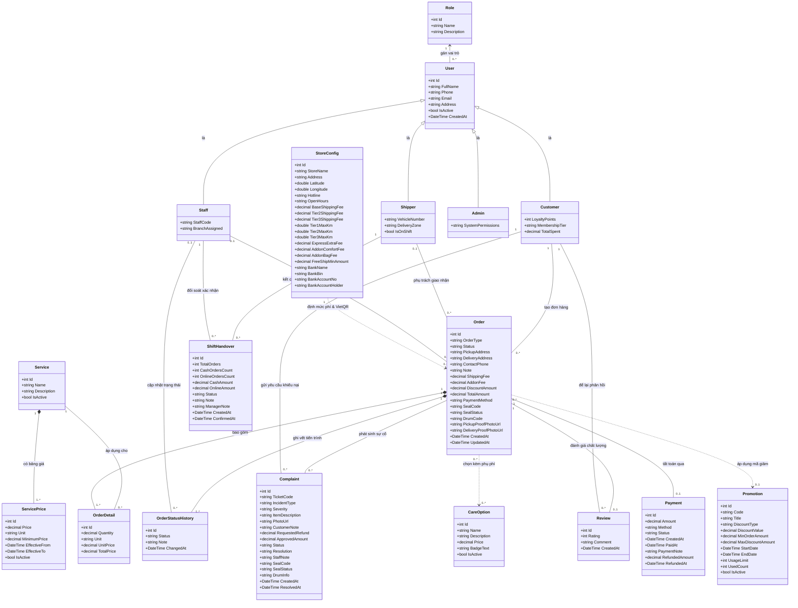

# TÀI LIỆU THIẾT KẾ HỆ THỐNG WASHSMART 3T
## BÁO CÁO THIẾT KẾ SƠ ĐỒ LỚP (MỨC PHÂN TÍCH & MỨC THIẾT KẾ)
**Đồ Án Tốt Nghiệp: Hệ Thống Quản Lý & Vận Hành Chuỗi Giặt Ủi Thông Minh WashSmart 3T**

---

## 1. TỔNG QUAN HỆ THỐNG VÀ PHƯƠNG PHÁP THIẾT KẾ

### 1.1. Giới thiệu tổng quan
Hệ thống **WashSmart 3T** là giải pháp phần mềm toàn diện phục vụ chuỗi cửa hàng giặt ủi hiện đại, tích hợp đa nền tảng gồm:
- **Web Quản trị & POS Quầy** (dành cho Admin, Quản lý chi nhánh, Lễ tân POS, Nhân viên kỹ thuật xưởng giặt).
- **Mobile App** (dành cho Khách hàng đặt giặt, theo dõi tiến độ, tích điểm 3T Xu và Shipper nhận ca, giao nhận đồ).
- **Backend API & Realtime Hub** (.NET 8 Web API, Entity Framework Core, SignalR Realtime Hub, tích hợp VietQR EMVCo ngân hàng MBBank).

### 1.2. Phân định Mức Phân tích vs. Mức Thiết kế
Trong quy trình phát triển phần mềm theo hướng đối tượng (OOAD), việc thiết kế sơ đồ lớp được chia làm 2 giai đoạn độc lập nhưng kế thừa chặt chẽ:
1. **Sơ đồ lớp mức Phân tích (Analysis Class Diagram / Conceptual Domain Model)**:
   - Tập trung vào **ngữ nghĩa nghiệp vụ thực tế (Business Domain)**.
   - Thể hiện các thực thể cốt lõi, thuộc tính bản chất và mối quan hệ tự nhiên giữa chúng (Khách hàng tạo Đơn hàng, Đơn hàng chứa Chi tiết dịch vụ, Đơn hàng thanh toán qua Giao dịch,...).
   - Độc lập hoàn toàn với ngôn ngữ lập trình, hệ quản trị CSDL, framework hay các thành phần kỹ thuật như DTO, Controller, DbContext.
2. **Sơ đồ lớp mức Thiết kế (Design Class Diagram / Software Architecture Model)**:
   - Cụ thể hóa cấu trúc phần mềm thực tế theo kiến trúc phân tầng (**Layered / Clean Architecture**).
   - Xác định rõ tầm vực truy cập (`+` public, `-` private, `#` protected), kiểu dữ liệu ngôn ngữ C# .NET 8 (`int`, `string`, `decimal`, `DateTime`, `enum`, `Task<IActionResult>`), các tham số hàm và giá trị trả về.
   - Bổ sung các lớp kỹ thuật: Controllers (Presentation Layer), Realtime Hubs, Service Providers, Data Transfer Objects (DTOs), Data Access DbContext, Enums và áp dụng các mẫu thiết kế (Design Patterns).

---

## 2. SƠ ĐỒ LỚP MỨC PHÂN TÍCH (ANALYSIS CLASS DIAGRAM)

### 2.1. Biểu đồ Mermaid mức Phân tích (Conceptual Domain Model)

### 2.2. Phân tích các mối quan hệ nghiệp vụ chính
1. **Quan hệ Kế thừa (Generalization)**:
   - `User` là lớp trừu tượng đại diện cho mọi đối tượng con người tương tác trong hệ thống (Họ tên, SĐT, Email, Mật khẩu, Trạng thái).
   - `Customer`, `Staff`, `Shipper`, `Admin` kế thừa các đặc tính cơ bản của `User` và mở rộng các thuộc tính nghiệp vụ đặc thù (Khách hàng có Điểm tích lũy và Hạng thành viên; Shipper có ca trực và quản lý tiền thu hộ).
2. **Quan hệ Hợp thành (Composition - `*--`)**:
   - `Order` *-- `OrderDetail`: Chi tiết mặt hàng giặt thuộc vòng đời của Đơn hàng. Nếu đơn hàng bị xóa hoặc khởi tạo, chi tiết đơn hàng gắn chặt với đơn hàng đó.
   - `Order` *-- `OrderStatusHistory`: Lịch sử trạng thái thuộc sở hữu toàn phần của đơn hàng nhằm phục vụ quy trình Audit Trail (truy xuất nguồn gốc tiến độ).
   - `Service` *-- `ServicePrice`: Dịch vụ giặt ủi sở hữu các mốc giá theo thời gian và đơn vị tính (`kg`, `cái`, `bộ`).
3. **Quan hệ Kết hợp (Association - `--`) & Tính bội số (Multiplicity)**:
   - `Customer [1]` -- `[0..*] Order`: Một khách hàng có thể đặt nhiều đơn hàng qua App hoặc POS quầy.
   - `Shipper [0..1]` -- `[0..*] Order`: Một đơn hàng giao tận nơi có thể được điều phối cho tối đa một Shipper phụ trách tại một thời điểm.
   - `Order [1]` -- `[0..1] Payment`: Mỗi đơn hàng tương ứng một giao dịch thanh toán xác thực.
   - `Order [1]` -- `[0..1] Review`: Khách hàng đánh giá 1 lần duy nhất cho mỗi đơn hàng đã hoàn tất (1..5 sao).
   - `Shipper [1]` -- `[0..*] ShiftHandover`: Cuối ca làm việc, shipper tổng hợp tiền mặt COD và đối soát với nhân viên quầy.

---

## 3. SƠ ĐỒ LỚP MỨC THIẾT KẾ (DESIGN CLASS DIAGRAM)

### 3.1. Kiến trúc phân tầng hệ thống (3-Tier Layered Architecture)
Hệ thống được thiết kế theo chuẩn hướng đối tượng trên nền tảng .NET 8 Web API:
- **Presentation / API Controller Layer**: Tiếp nhận HTTP Request từ Web Portal và Mobile App, thực hiện xác thực Claims, phân quyền RBAC và điều phối gọi xuống Business Services hoặc DbContext.
- **Realtime Notification Layer**: SignalR Hub (`OrderNotificationHub`) phát sóng sự kiện tức thời đến màn hình bếp xưởng, app shipper và quầy POS.
- **Business / Domain Services Layer**: Chứa các quy tắc nghiệp vụ độc lập (`LoyaltyService`, `VietQrService`, `AccountLockoutManager`, `OtpManager`, `SmsService`, `EmailService`).
- **Data Transfer Objects (DTO) Layer**: Đóng gói dữ liệu đầu vào / đầu ra, ngăn chặn lỗi lỗ hổng Over-posting và bảo mật dữ liệu nhạy cảm.
- **Data Access & Persistence Layer**: `ApplicationDbContext` kế thừa từ `DbContext` của Entity Framework Core, ánh xạ các Entity POCO sang Microsoft SQL Server.

### 3.2. Biểu đồ Mermaid mức Thiết kế (Detailed Implementation Model)

```mermaid
classDiagram
    direction TB

    %% ==========================================
    %% TẦNG PRESENTATION / CONTROLLER LAYER
    %% ==========================================
    class OrdersController {
        -ApplicationDbContext _context
        -IWebHostEnvironment _env
        -ILogger~OrdersController~ _logger
        -IHubContext~OrderNotificationHub~ _hubContext
        +GetOrdersForManagement() Task~IActionResult~
        +GetOrderById(id: int) Task~IActionResult~
        +CreatePosOrder(request: CreateOrderRequest) Task~IActionResult~
        +CreateCustomerOrder(request: CreateOrderRequest) Task~IActionResult~
        +UpdateOrderStatus(id: int, request: UpdateOrderStatusRequest) Task~IActionResult~
        +AssignShipper(id: int, shipperId: int) Task~IActionResult~
        +ConfirmPickup(id: int, request: PickupConfirmationRequest) Task~IActionResult~
        +ConfirmDelivery(id: int, request: DeliveryConfirmationRequest) Task~IActionResult~
        -CalculateShippingFee(distanceKm: double, isExpress: bool, config: StoreConfig) decimal
        -GetStoreConfig() StoreConfig
    }

    class AuthController {
        -ApplicationDbContext _context
        -IConfiguration _config
        +Login(request: LoginRequest) Task~IActionResult~
        +Register(request: RegisterRequest) Task~IActionResult~
        +SendOtp(request: SendOtpRequest) Task~IActionResult~
        +VerifyOtp(request: VerifyOtpRequest) Task~IActionResult~
        +ForgotPassword(phone: string) Task~IActionResult~
        -GenerateJwtToken(user: User, roleName: string) string
    }

    class PaymentsController {
        -ApplicationDbContext _context
        +GenerateVietQr(orderId: int) Task~IActionResult~
        +ConfirmPayment(request: CreatePaymentRequest) Task~IActionResult~
        +GetPaymentByOrderId(orderId: int) Task~IActionResult~
        +RefundPayment(orderId: int, request: RefundRequest) Task~IActionResult~
    }

    class ComplaintsController {
        -ApplicationDbContext _context
        +GetComplaints(status: string) Task~IActionResult~
        +CreateComplaint(request: CreateComplaintRequest) Task~IActionResult~
        +ResolveComplaint(id: int, request: ResolveComplaintRequest) Task~IActionResult~
    }

    class ShiftHandoverController {
        -ApplicationDbContext _context
        +GetShiftSummary(shipperId: int) Task~IActionResult~
        +CreateHandover(dto: CreateShiftHandoverDto) Task~IActionResult~
        +ConfirmHandover(id: int, dto: ConfirmHandoverDto) Task~IActionResult~
    }

    class ServicesController {
        -ApplicationDbContext _context
        +GetServices() Task~IActionResult~
        +CreateService(dto: ServiceCreateRequest) Task~IActionResult~
        +UpdatePrice(id: int, dto: ServicePriceUpdateRequest) Task~IActionResult~
        +ToggleActive(id: int) Task~IActionResult~
    }

    class CareOptionsController {
        -ApplicationDbContext _context
        +GetCareOptions() Task~IActionResult~
        +Create(option: CareOption) Task~IActionResult~
        +Update(id: int, option: CareOption) Task~IActionResult~
        +Delete(id: int) Task~IActionResult~
    }

    class StoreConfigController {
        -ApplicationDbContext _context
        +GetConfig() Task~IActionResult~
        +UpdateConfig(config: StoreConfig) Task~IActionResult~
    }

    %% ==========================================
    %% TẦNG REALTIME NOTIFICATION (SIGNALR)
    %% ==========================================
    class OrderNotificationHub {
        +JoinBranchGroup(branchId: string) Task
        +NotifyNewOrder(orderId: int, customerName: string) Task
        +NotifyOrderStatusChanged(orderId: int, status: string) Task
        +NotifyShipperAssigned(orderId: int, shipperId: int) Task
    }

    %% ==========================================
    %% TẦNG BUSINESS & DOMAIN SERVICES
    %% ==========================================
    class LoyaltyService {
        +CalculateTier(totalSpent: decimal, loyaltyPoints: int)$ string
        +AwardLoyalty(customer: User, paidAmount: decimal)$ int
        +CompensatePoints(customer: User, points: int)$ void
    }

    class VietQrService {
        +GenerateVietQr(bankBin: string, accountNo: string, accountHolder: string, amount: decimal, memo: string)$ VietQrResult
        +CalculateCrc16(data: string)$ string
        -FormatTlv(tag: string, value: string)$ string
    }

    class AccountLockoutManager {
        -ConcurrentDictionary~string, LockoutInfo~ _attempts$
        +IsLockedOut(phone: string)$ bool
        +RecordFailedAttempt(phone: string)$ void
        +ResetLockout(phone: string)$ void
        +GetRemainingLockoutMinutes(phone: string)$ int
    }

    class OtpManager {
        -ConcurrentDictionary~string, OtpEntry~ _otpStore$
        +GenerateOtp(purpose: string, phone: string)$ string
        +ValidateOtp(purpose: string, phone: string, code: string)$ bool
    }

    class SmsService {
        +SendOtpSmsAsync(phone: string, otp: string) Task~bool~
        +NormalizePhone(phone: string)$ Tuple~string, string, string~
    }

    class EmailService {
        +SendOtpEmailAsync(toEmail: string, otp: string) Task~bool~
        +SendWelcomeEmailAsync(toEmail: string, name: string) Task~bool~
    }

    %% ==========================================
    %% TẦNG DATA TRANSFER OBJECTS (DTOs)
    %% ==========================================
    class CreateOrderRequest {
        +int? CustomerId
        +string CustomerName
        +string CustomerPhone
        +string OrderType
        +string PickupAddress
        +string DeliveryAddress
        +double DistanceKm
        +bool IsExpress
        +List~OrderItemDto~ Items
        +List~string~ CareOptionIds
        +string PaymentMethod
        +string Note
        +string PromoCode
    }

    class OrderItemDto {
        +int ServiceId
        +decimal Quantity
        +string Unit
    }

    class PickupConfirmationRequest {
        +string SealCode
        +string? DrumCode
        +string? PickupProofPhotoUrl
        +string? Note
    }

    class CreateShiftHandoverDto {
        +decimal CashAmount
        +decimal OnlineAmount
        +int TotalOrders
        +int CashOrdersCount
        +int OnlineOrdersCount
        +List~int~ OrderIds
        +string Note
    }

    class VietQrResult {
        +string EmvCoString
        +string QrImageUrl
        +decimal Amount
        +string OrderCode
        +string BankBin
        +string BankAccountNo
        +string BankAccountHolder
    }

    class LoginRequest {
        +string Phone
        +string Password
    }

    %% ==========================================
    %% TẦNG DATA ACCESS LAYER (ORM / EF CORE)
    %% ==========================================
    class ApplicationDbContext {
        +DbSet~User~ Users
        +DbSet~Role~ Roles
        +DbSet~Order~ Orders
        +DbSet~OrderDetail~ OrderDetails
        +DbSet~OrderStatusHistory~ OrderStatusHistories
        +DbSet~Payment~ Payments
        +DbSet~Review~ Reviews
        +DbSet~Complaint~ Complaints
        +DbSet~StoreConfig~ StoreConfigs
        +DbSet~Promotion~ Promotions
        +DbSet~CareOption~ CareOptions
        +DbSet~ShiftHandover~ ShiftHandovers
        +DbSet~Service~ Services
        +DbSet~ServicePrice~ ServicePrices
        #OnModelCreating(modelBuilder: ModelBuilder) void
    }

    %% ==========================================
    %% TẦNG DOMAIN ENTITIES & ENUMS
    %% ==========================================
    class User {
        +int Id
        +string FullName
        +string Phone
        +string Email
        +string? Address
        +string PasswordHash
        +int RoleId
        +Role? Role
        +bool IsActive
        +int LoyaltyPoints
        +string MembershipTier
        +decimal TotalSpent
        +DateTime CreatedAt
    }

    class Role {
        +int Id
        +string Name
        +string Description
        +ICollection~User~ Users
    }

    class Order {
        +int Id
        +int CustomerId
        +User? Customer
        +int? ShipperId
        +User? Shipper
        +OrderStatus Status
        +string OrderType
        +string PickupAddress
        +string DeliveryAddress
        +string ContactPhone
        +string? Note
        +decimal ShippingFee
        +decimal AddonFee
        +decimal DiscountAmount
        +decimal TotalAmount
        +string PaymentMethod
        +string? SealCode
        +string? SealStatus
        +string? DrumCode
        +string? PickupProofPhotoUrl
        +string? DeliveryProofPhotoUrl
        +DateTime CreatedAt
        +DateTime? UpdatedAt
        +ICollection~OrderDetail~ OrderDetails
    }

    class OrderDetail {
        +int Id
        +int OrderId
        +Order? Order
        +int ServiceId
        +Service? Service
        +decimal Quantity
        +string Unit
        +decimal UnitPrice
        +decimal TotalPrice
    }

    class OrderStatusHistory {
        +int Id
        +int OrderId
        +Order? Order
        +OrderStatus Status
        +string? Note
        +int? ChangedByUserId
        +User? ChangedByUser
        +DateTime ChangedAt
    }

    class Payment {
        +int Id
        +int OrderId
        +Order? Order
        +decimal Amount
        +PaymentMethod Method
        +PaymentStatus Status
        +DateTime CreatedAt
        +DateTime? PaidAt
        +string? PaymentNote
        +decimal? RefundedAmount
        +string? RefundReason
        +DateTime? RefundedAt
        +string? RefundedBy
    }

    class Service {
        +int Id
        +string Name
        +string Description
        +bool IsActive
        +DateTime CreatedAt
        +DateTime? UpdatedAt
        +ICollection~ServicePrice~ Prices
    }

    class ServicePrice {
        +int Id
        +int ServiceId
        +Service? Service
        +decimal Price
        +string Unit
        +decimal? MinimumPrice
        +DateTime EffectiveFrom
        +DateTime? EffectiveTo
        +bool IsActive
        +DateTime CreatedAt
    }

    class CareOption {
        +int Id
        +string Name
        +string Description
        +decimal Price
        +string? BadgeText
        +bool IsActive
        +DateTime CreatedAt
        +DateTime? UpdatedAt
    }

    class ShiftHandover {
        +int Id
        +int ShipperId
        +User? Shipper
        +int TotalOrders
        +int CashOrdersCount
        +int OnlineOrdersCount
        +decimal CashAmount
        +decimal OnlineAmount
        +string Status
        +string? Note
        +string? ManagerNote
        +int? ConfirmedByUserId
        +User? ConfirmedByUser
        +DateTime CreatedAt
        +DateTime? ConfirmedAt
        +string? OrderIdsJson
    }

    class Complaint {
        +int Id
        +string TicketCode
        +int? CustomerId
        +User? Customer
        +int? OrderId
        +Order? Order
        +string OrderCode
        +string IncidentType
        +string Severity
        +string ItemDescription
        +string? PhotoUrl
        +string? CustomerNote
        +decimal RequestedRefund
        +decimal? ApprovedAmount
        +string Status
        +string? Resolution
        +string? StaffNote
        +string? ResolvedBy
        +DateTime? ResolvedAt
        +string? SealCode
        +string? SealStatus
        +string? DrumInfo
        +string? ShipperName
        +DateTime CreatedAt
    }

    class StoreConfig {
        +int Id
        +string StoreName
        +string Address
        +double Latitude
        +double Longitude
        +string Hotline
        +string OpenHours
        +decimal BaseShippingFee
        +decimal Tier2ShippingFee
        +decimal Tier3ShippingFee
        +double Tier1MaxKm
        +double Tier2MaxKm
        +double Tier3MaxKm
        +decimal ExpressExtraFee
        +decimal AddonComfortFee
        +decimal AddonBagFee
        +decimal FreeShipMinAmount
        +string BankName
        +string BankBin
        +string BankAccountNo
        +string BankAccountHolder
        +string SmsApiKey
        +string SmsApiSecret
        +string SmsBrandName
        +string SmsOtpTemplate
        +DateTime UpdatedAt
    }

    class OrderStatus {
        <<enumeration>>
        Pending
        Confirmed
        PickingUp
        Received
        Washing
        Ready
        Delivering
        Completed
        Cancelled
    }

    class PaymentMethod {
        <<enumeration>>
        Cash
        MoMo
        BankTransfer
    }

    class PaymentStatus {
        <<enumeration>>
        Pending
        Paid
        Failed
        Refunded
    }

    %% ==========================================
    %% QUAN HỆ KIẾN TRÚC & PHỤ THUỘC (DEPENDENCY & USAGE)
    %% ==========================================
    OrdersController --> ApplicationDbContext : injects
    OrdersController --> OrderNotificationHub : sends realtime
    OrdersController ..> CreateOrderRequest : consumes
    OrdersController ..> PickupConfirmationRequest : consumes
    OrdersController ..> LoyaltyService : calls
    OrdersController ..> Order : manages

    AuthController --> ApplicationDbContext : injects
    AuthController ..> LoginRequest : consumes
    AuthController ..> OtpManager : calls
    AuthController ..> AccountLockoutManager : checks
    AuthController ..> SmsService : calls
    AuthController ..> EmailService : calls

    PaymentsController --> ApplicationDbContext : injects
    PaymentsController ..> VietQrService : calls
    PaymentsController ..> LoyaltyService : awards points
    PaymentsController ..> VietQrResult : returns

    ShiftHandoverController --> ApplicationDbContext : injects
    ShiftHandoverController ..> CreateShiftHandoverDto : consumes

    ComplaintsController --> ApplicationDbContext : injects
    ComplaintsController ..> LoyaltyService : compensates

    ServicesController --> ApplicationDbContext : injects
    CareOptionsController --> ApplicationDbContext : injects
    StoreConfigController --> ApplicationDbContext : injects

    ApplicationDbContext --> User : contains DbSet
    ApplicationDbContext --> Role : contains DbSet
    ApplicationDbContext --> Order : contains DbSet
    ApplicationDbContext --> OrderDetail : contains DbSet
    ApplicationDbContext --> OrderStatusHistory : contains DbSet
    ApplicationDbContext --> Payment : contains DbSet
    ApplicationDbContext --> Service : contains DbSet
    ApplicationDbContext --> ServicePrice : contains DbSet
    ApplicationDbContext --> CareOption : contains DbSet
    ApplicationDbContext --> ShiftHandover : contains DbSet
    ApplicationDbContext --> Complaint : contains DbSet
    ApplicationDbContext --> StoreConfig : contains DbSet

    %% Quan hệ giữa các Entity
    User "1" --> "0..*" Order : Customer
    User "1" --> "0..*" Order : Shipper
    User "1" --> "1" Role : RoleId
    Order "1" *-- "1..*" OrderDetail : OrderDetails
    Order "1" *-- "1..*" OrderStatusHistory : Histories
    Order --> OrderStatus : has status
    Payment --> PaymentMethod : has method
    Payment --> PaymentStatus : has status
    Order "1" -- "0..1" Payment : OrderId
    Service "1" *-- "1..*" ServicePrice : Prices
    OrderDetail "0..*" --> "1" Service : ServiceId
    ShiftHandover "0..*" --> "1" User : ShipperId
    ShiftHandover "0..*" --> "0..1" User : ConfirmedByUserId
    Complaint "0..*" --> "0..1" Order : OrderId
    Complaint "0..*" --> "0..1" User : CustomerId
```

---

## 4. BẢNG MÔ TẢ TRÁCH NHIỆM & CỘNG TÁC (CRC CARDS)

Bảng phân tích trách nhiệm lớp (Class Responsibility Collaborator - CRC) phân tích chi tiết vai trò của các lớp chính trong hệ thống:

| Lớp (Class) | Trách nhiệm chính (Responsibilities) | Các lớp cộng tác (Collaborators) |
|---|---|---|
| **OrdersController** | - Tiếp nhận và xác thực đơn đặt từ Khách hàng & Lễ tân POS. - Tính toán cước phí vận chuyển lũy tiến theo cự ly Km và gói hỏa tốc. - Quản lý quy trình 9 bước chuyển đổi trạng thái đơn hàng. - Tiếp nhận bằng chứng giao nhận (Mã seal, mã lồng, ảnh chụp). | `ApplicationDbContext`, `OrderNotificationHub`, `LoyaltyService`, `Order`, `OrderDetail`, `StoreConfig`, `CreateOrderRequest` |
| **AuthController** | - Xác thực tài khoản nhân viên và khách hàng bằng SĐT/Mật khẩu. - Cấp phát mã định danh JWT Token kèm Claims theo vai trò. - Quản lý chu trình OTP xác thực qua SMS và Email. - Chặn tấn công Brute-force qua cơ chế khóa tài khoản tạm thời. | `ApplicationDbContext`, `OtpManager`, `AccountLockoutManager`, `SmsService`, `EmailService`, `User` |
| **PaymentsController** | - Khởi tạo mã QR thanh toán động VietQR chuẩn EMVCo khóa cứng số tiền. - Xác nhận giao dịch thanh toán thành công (Tiền mặt hoặc Chuyển khoản). - Tự động kích hoạt cộng điểm thưởng Loyalty 3T Xu cho khách. - Xử lý quy trình hoàn tiền bồi hoàn khiếu nại. | `ApplicationDbContext`, `VietQrService`, `LoyaltyService`, `Payment`, `Order` |
| **LoyaltyService** | - Tính toán cấp bậc thành viên (Đồng, Bạc, Vàng, Kim Cương). - Tích lũy 3T Xu thưởng dựa trên giá trị thanh toán thực tế (1.000đ = 1 Xu). - Cộng điểm bồi hoàn theo quyết định bảo hiểm 3T Care. | `User` |
| **VietQrService** | - Đóng gói dữ liệu chuỗi EMVCo theo chuẩn NAPAS 247. - Tính toán checksum bảo mật CRC-16 CCITT (đa thức 0x1021). - Tạo URL ảnh VietQR hiển thị trực tiếp trên giao diện POS và App. | `VietQrResult`, `StoreConfig` |
| **OrderNotificationHub** | - Quản lý kết nối WebSocket/SignalR thời gian thực. - Bắn tín hiệu tức thời khi có đơn hàng mới đến chuông báo POS quầy. - Đồng bộ trạng thái đơn hàng tức thời đến ứng dụng của Khách hàng và Shipper. | `OrdersController`, Web Client, Flutter Mobile Client |
| **ComplaintsController** | - Tiếp nhận yêu cầu khiếu nại/bảo hiểm 3T Care khi có sự cố đồ giặt. - Cho phép nhân viên thẩm định mức độ hư hại/thất lạc và nhập số tiền bồi thường. - Cập nhật giải pháp xử lý (Hoàn tiền qua VietQR hoặc Tích điểm Xu). | `ApplicationDbContext`, `LoyaltyService`, `Complaint`, `Payment` |
| **ShiftHandoverController** | - Thống kê số lượng đơn và tổng số tiền Shipper đã thu trong ca (COD vs Online). - Lập biên bản bàn giao nộp tiền mặt giữa Shipper và Lễ tân POS. - Khóa sổ và ghi vết lịch sử bàn giao quỹ ca. | `ApplicationDbContext`, `ShiftHandover`, `Order`, `User` |
| **ApplicationDbContext** | - Ánh xạ các thực thể (POCO) sang bảng CSDL quan hệ SQL Server. - Quản lý Transaction, theo dõi trạng thái thực thể (Change Tracking). - Đảm bảo quy tắc toàn vẹn tham chiếu và chuyển đổi múi giờ chuẩn UTC. | Toàn bộ các Entity Models |

---

## 5. CÁC MẪU THIẾT KẾ (DESIGN PATTERNS) ĐƯỢC ÁP DỤNG

1. **Repository & Unit of Work Pattern (Tích hợp qua EF Core `DbContext`)**:
   - `ApplicationDbContext` đóng vai trò là một `Unit of Work`, đảm bảo các thao tác ghi nhận đơn hàng, thêm chi tiết, trừ voucher và ghi lịch sử trạng thái diễn ra trong một giao dịch nguyên tử (`Atomic Transaction`).
   - Mỗi `DbSet<T>` đóng vai trò là một `Generic Repository` trừu tượng hóa việc truy vấn CSDL.
2. **Data Transfer Object (DTO) Pattern**:
   - Tách biệt hoàn toàn mô hình lưu trữ CSDL (`Entity`) và dữ liệu truyền nhận qua mạng (`DTO`).
   - Ví dụ: `CreateOrderRequest` gom dữ liệu đặt hàng gồm danh sách dịch vụ, tiện ích, cự ly km và mã giảm giá để Controller xử lý, tránh phơi bày cấu trúc bảng `Order` ra ngoài Internet.
3. **Dependency Injection (DI Pattern)**:
   - Các Controllers nhận `ApplicationDbContext`, `ILogger`, `IHubContext` thông qua cơ chế Constructor Injection của ASP.NET Core, giúp mã nguồn lỏng lẻo (loose coupling) và dễ dàng viết Unit Test.
4. **Observer Pattern (Publish / Subscribe qua SignalR)**:
   - `OrderNotificationHub` hoạt động như một Event Dispatcher. Khi có đơn hàng phát sinh từ ứng dụng di động của khách hàng, sự kiện được phát tới tất cả các kết nối Web POS đang trực chiến mà không cần trình duyệt phải gửi yêu cầu thăm dò liên tục (polling).
5. **State Pattern (Quản lý vòng đời đơn hàng)**:
   - Trạng thái đơn hàng tuân thủ máy trạng thái hữu hạn 9 bước (`Pending` -> `Confirmed` -> `PickingUp` -> `Received` -> `Washing` -> `Ready` -> `Delivering` -> `Completed` / `Cancelled`), mỗi bước chuyển đổi đều kích hoạt ghi vết vào `OrderStatusHistory`.
6. **Strategy / Factory Helper Pattern**:
   - `VietQrService` đóng gói thuật toán tạo mã EMVCo chuẩn ngân hàng độc lập với luồng xử lý đơn hàng.

---

## 6. SO SÁNH QUÁ TRÌNH CHUYỂN HÓA TỪ PHÂN TÍCH SANG THIẾT KẾ

| Tiêu chí so sánh | Sơ đồ lớp Mức Phân tích (Analysis) | Sơ đồ lớp Mức Thiết kế (Design) |
|---|---|---|
| **Mục đích** | Mô hình hóa thế giới thực và yêu cầu nghiệp vụ giặt ủi của khách hàng, nhân viên, shipper. | Hướng dẫn hiện thực hóa mã nguồn phần mềm trên nền tảng .NET 8, C# và CSDL SQL Server. |
| **Đối tượng biểu diễn** | Các thực thể miền (`Domain Entities`) thuần túy nghiệp vụ. | Bao gồm Entities, Controllers, Realtime Hubs, Services, DTOs, Enums và DbContext. |
| **Kiểu dữ liệu** | Trừu tượng (Số, Chuỗi, Ngày giờ, Boolean). | Kiểu cụ thể trong C# (`int`, `decimal`, `string`, `DateTime`, `Task<IActionResult>`). |
| **Hành vi (Methods)** | Thường ẩn hoặc chỉ nêu các trách nhiệm nghiệp vụ cấp cao. | Khai báo đầy đủ tên hàm, tham số, kiểu trả về và mức độ truy cập (`+`, `-`, `#`). |
| **Phụ thuộc công nghệ** | Độc lập 100% với nền tảng công nghệ và framework. | Ràng buộc cụ thể với ASP.NET Core Web API, Entity Framework Core và SignalR. |

---
*Tài liệu này được xuất tự động từ mã nguồn thực tế của dự án WashSmart 3T, phục vụ báo cáo và bảo vệ Đồ Án Tốt Nghiệp.*
