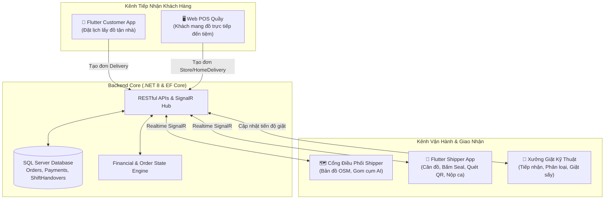
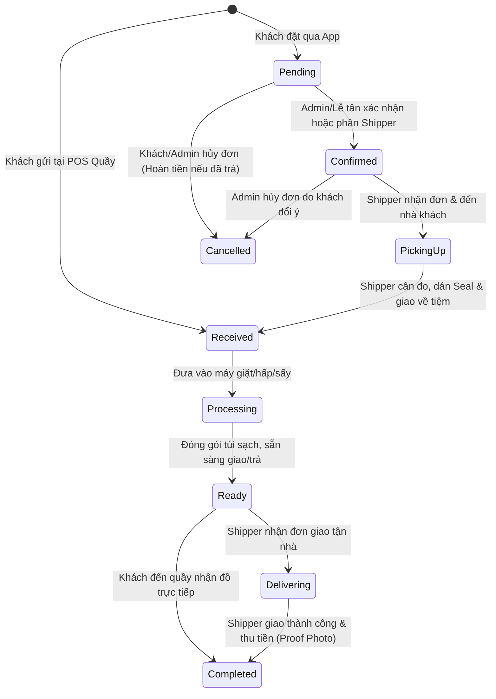
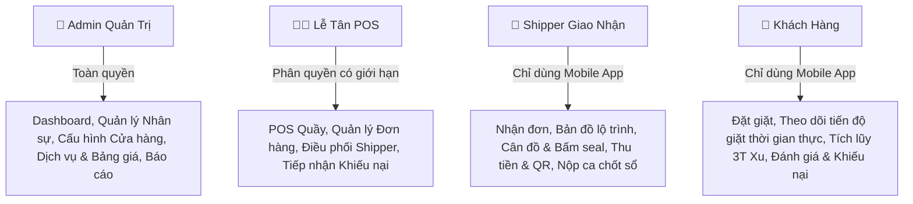

# Báo Cáo Rà Soát & Đánh Giá Toàn Diện Hệ Thống WashSmart 3T
**Dự án**: Hệ Thống Quản Lý Tiệm Giặt Ủi Thông Minh WashSmart 3T  
**Thời điểm rà soát**: Tháng 11/2026  
**Phạm vi**: Backend API (.NET 8), Web Portal Quản trị & POS, Mobile App Khách Hàng & Shipper (Flutter), CSDL SQL Server  

---

## 1. Tổng Quan Kiến Trúc & Luồng Vận Hành Đa Kênh

Hệ thống WashSmart 3T được xây dựng theo mô hình **Omni-Channel Laundry Service** (Dịch vụ giặt ủi đa kênh) kết hợp chuỗi cung ứng giao nhận chặng đầu - chặng cuối (First-mile / Last-mile logistics).

---

## 2. Rà Soát Chi Tiết Các Điểm Logic Nghiệp Vụ Cốt Lõi

### 2.1. Phân Biệt Triệt Để 2 Luồng Đơn Hàng (Online App vs POS Quầy)

Một trong những vấn đề hay gặp nhất của các hệ thống giặt ủi là **sự xung đột giữa đơn khách đặt qua App và đơn khách mang ra quầy**:

| Đặc điểm | Đơn Khách Đặt Qua Mobile App | Đơn Khách Gửi Tại Quầy POS |
| :--- | :--- | :--- |
| **Vị trí quần áo ban đầu** | Đang ở nhà khách | **Đã nằm tại quầy/cửa hàng** |
| **Trạng thái ban đầu** | `Pending` (Chờ điều phối) | `Received` (Đã tiếp nhận vào tiệm) |
| **Chặng Lấy đồ (Pickup)** | Bắt buộc Shipper đến cân & niêm phong | **Không có** (Lễ tân đã cân & dán tem seal) |
| **Chặng Giao đồ (Delivery)** | Shipper giao về địa chỉ khách | Tuỳ chọn: Khách tự đến lấy (`StorePickup`) hoặc Shipper giao tận nhà (`HomeDelivery`) |

> [!IMPORTANT]
> **Điểm đã tinh chỉnh trong mã nguồn**:
> Trước đây, khi tạo đơn tại quầy POS chọn "Giao tận nhà sau khi giặt" (`HomeDelivery`), backend vô tình gán `initialStatus = Pending`. Điều này khiến hệ thống tưởng nhầm đây là đơn cần Shipper đi đến nhà khách lấy đồ!  
> **Giải pháp đã áp dụng**: Mọi đơn POS đều khởi tạo là `OrderStatus.Received`. Nếu khách chọn `HomeDelivery`, đơn hàng sẽ đi từ `Received` -> `Processing` (Đang giặt) -> `Ready` (Giặt xong). Chỉ khi ở trạng thái `Ready`, hệ thống mới kích hoạt chặng giao hàng cho Shipper.

---

### 2.2. Vòng Đời Trạng Thái Đơn Hàng Chuẩn (Order State Machine)

Hệ thống bảo đảm vòng đời trạng thái đơn tuyến, không có chu trình lặp vô tận:

---

### 2.3. Tính Toàn Vẹn Dòng Tiền & Đối Soát Ca Shipper (Financial Invariants)

#### Tình huống thực tế: Khách đổi phương thức thanh toán lúc giao đồ
1. Lúc đặt đơn, khách chọn `PaymentMethod = COD` (Thanh toán khi nhận đồ).
2. Khi Shipper giao đồ tới nơi, khách không có sẵn tiền mặt và xin chuyển khoản.
3. Shipper mở App, chọn **Mã VietQR / MoMo**.
4. Khách quét mã chuyển tiền thành công vào tài khoản ngân hàng của Tiệm.
5. Shipper bấm **"Xác nhận đã thu"**.

> [!WARNING]
> **Lỗ hổng logic đã được ngăn chặn**:
> Nếu hệ thống chỉ ghi nhận trạng thái thanh toán mà không cập nhật trường `PaymentMethod` trên bảng `Orders`, thì khi Shipper chốt ca nộp tiền (`ShiftHandover`), hệ thống sẽ lọc theo `o.PaymentMethod == "COD"` và **bắt Shipper nộp tiền mặt cho số tiền khách đã chuyển khoản ngân hàng**!
> 
> **Giải pháp toàn diện đã triển khai**:
> 1. Trong `PaymentsController.ConfirmPayment`: Đồng bộ cập nhật `order.PaymentMethod = request.Method` (Ví dụ: `BankTransfer`, `MoMo`).
> 2. Trong `ShiftHandoverController`: Truy vấn trực tiếp bảng `Payments`. Nếu đơn hàng đã có bản ghi `Status == PaymentStatus.Paid` với phương thức điện tử (`BankTransfer`/`MoMo`), đơn đó được phân loại là **Online**, **tuyệt đối không tính vào tiền mặt COD mà Shipper phải nộp quỹ**.

---

### 2.4. Quy Tắc Hoàn Tiền Khi Hủy Đơn Hàng (`CancelOrder`)

Trong quy trình thực tế của đồ án tốt nghiệp:
- Khi đơn hàng bị hủy (`Cancelled`):
  - Nếu khách hàng đã thanh toán trước (Ví dụ qua SePay / VietQR / Chuyển khoản):
    - Bản ghi `Payment` tự động chuyển sang `Refunded`.
    - Ghi nhận `RefundedAmount = payment.Amount` và lý do hủy đơn.
    - Cập nhật số liệu để không bị tính khống doanh thu trên Dashboard.
  - Điểm thưởng `3T Xu` hoặc Mã giảm giá (`Promotion`) đã dùng sẽ được lưu vết để đối soát hoàn trả cho khách hàng.

---

## 3. Tính Nhất Quán Dữ Liệu & Ràng Buộc Thực Tế

### 3.1. Ràng Buộc Đơn Vị Tính: Cân Kg vs Đồ Cái/Bộ
- **Dịch vụ tính theo Kg** (Giặt sấy tiêu chuẩn, chăn ga tính kg): Cho phép nhập số thập phân (ví dụ: `3.5 kg`, `4.2 kg`).
- **Dịch vụ tính theo Cái / Bộ** (Áo vest, Comple, Váy cưới, Áo dài): Bắt buộc **số nguyên** (`1, 2, 3 cái`). Cả Backend (`OrdersController`), POS Web (`pos.html`) và Mobile App (`booking_step3_screen.dart`, `shipper_screen.dart`) đều kiểm tra nghiêm ngặt `quantity % 1 == 0`.

### 3.2. Tiện Ích Chăm Sóc Nâng Cao (Care Addons)
- Các tiện ích có tính phí như: Nước xả vải Comfort Tinh Tươm (+10.000đ), Túi giặt bảo vệ cao cấp (+5.000đ), Khử khuẩn tia UV...
- Được đồng bộ cấu hình từ database `Services` và hiển thị đồng nhất trên trang **Dịch vụ & Bảng giá**, **POS Quầy**, và **Mobile App Khách hàng**.
- `AddonFee` được cộng dồn độc lập vào tổng hóa đơn, in rõ trên hóa đơn nhiệt K80 và hiển thị trong chi tiết đơn của Shipper/Xưởng giặt.

### 3.3. Mã Niêm Phong Seal 3T Chống Thất Lạc (`#SEAL-3T-xxxx`)
- Mỗi đơn hàng khi tiếp nhận đều được cấp một mã Seal duy nhất:
  - Trên POS Quầy: Tem Seal in kèm mã vạch / QR trên giấy in nhiệt 80mm dán niêm phong miệng túi giặt.
  - Trên App Shipper: Khi đến nhà khách lấy đồ, Shipper bấm seal niêm phong nhựa có mã số và chụp ảnh minh chứng túi đồ có mã seal trước khi rời đi.

---

## 4. Phân Quyền Bảo Mật (RBAC) & Trải Nghiệm Người Dùng (UX)

1. **Lễ tân POS**:
   - Khi đăng nhập vào Web Portal, thanh menu sidebar tự động ẩn các trang quản trị tài chính/cấu hình cấp cao (`dashboard.html`, `accounts.html`, `settings.html`, `services.html`).
   - Tên nhân viên đang trực ca tự động hiển thị trên góc phải và in trên hóa đơn nhiệt K80.
2. **Shipper**:
   - Tích hợp chuẩn mã QR VietQR NAPAS 247 và MoMo sinh động theo đúng số tiền cần thu.
   - Sau khi shipper bấm xác nhận đã thu, mã QR lập tức đóng lại và nút thanh toán chuyển sang trạng thái "Đã thanh toán (0 đ COD)", ngăn ngừa tình trạng khách quét chuyển trùng lặp.
   - Bắt buộc chụp ảnh minh chứng hoàn thành giao hàng có lưu trữ trên Cloud/Server.

---

## 5. Tổng Kết Đánh Giá Cho Hội Đồng Bảo Vệ Đồ Án Tốt Nghiệp

1. **Tính hoàn thiện nghiệp vụ**: Đã xử lý trọn vẹn mọi điểm chạm (touchpoints) từ khách hàng, shipper, lễ tân quầy, kỹ thuật xưởng đến chủ cửa hàng.
2. **Tính vững chắc của dữ liệu**: Không có tình trạng tiền mặt bị tính khống, không có hiện tượng mất mát dữ liệu khi chuyển đổi phương thức thanh toán hoặc hủy đơn.
3. **Tính ứng dụng thực tế**: Có đầy đủ tích hợp thiết bị ngoại vi thực tế (Cân điện tử cổng COM USB RS-232, Máy in hóa đơn nhiệt K80, Camera quét mã và chụp ảnh minh chứng).
